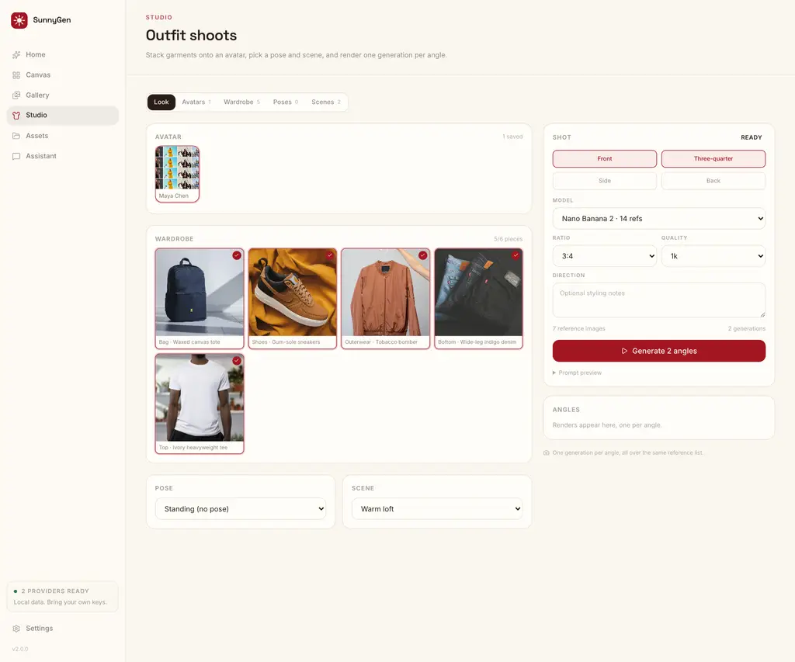
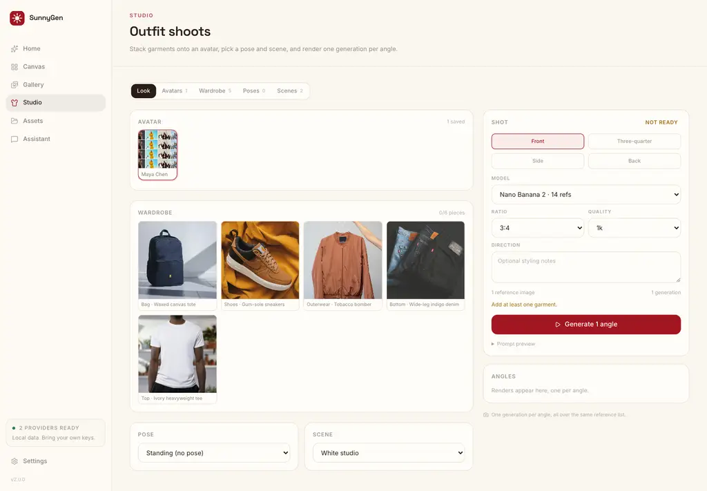
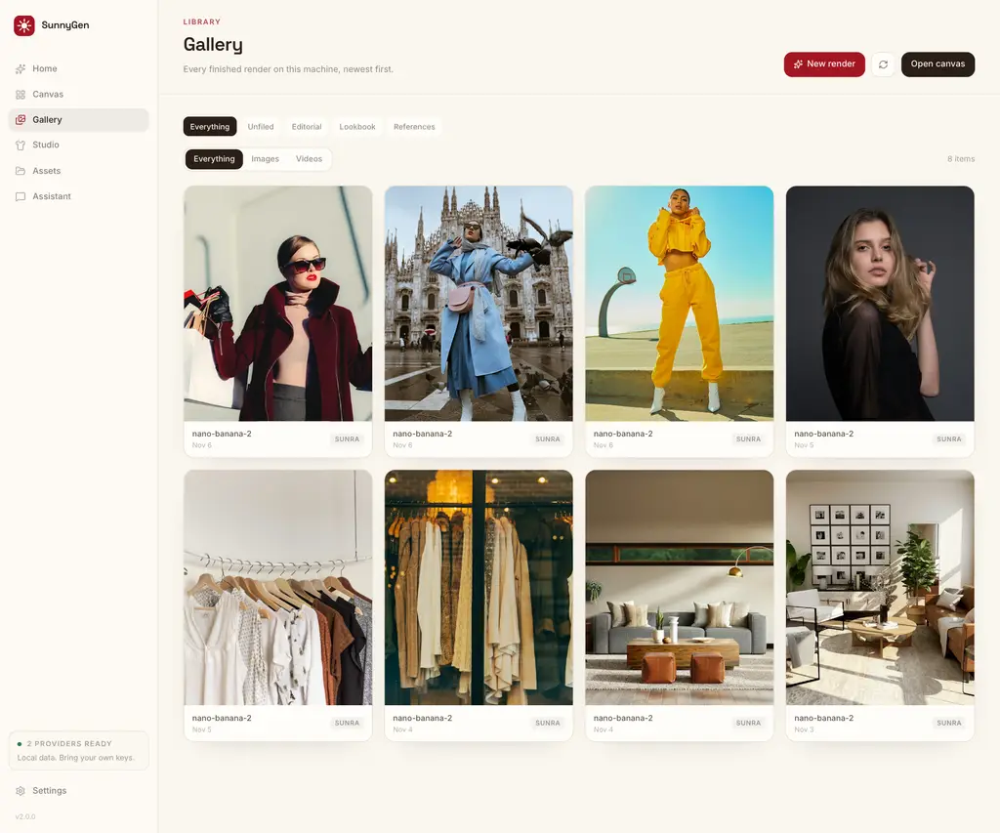
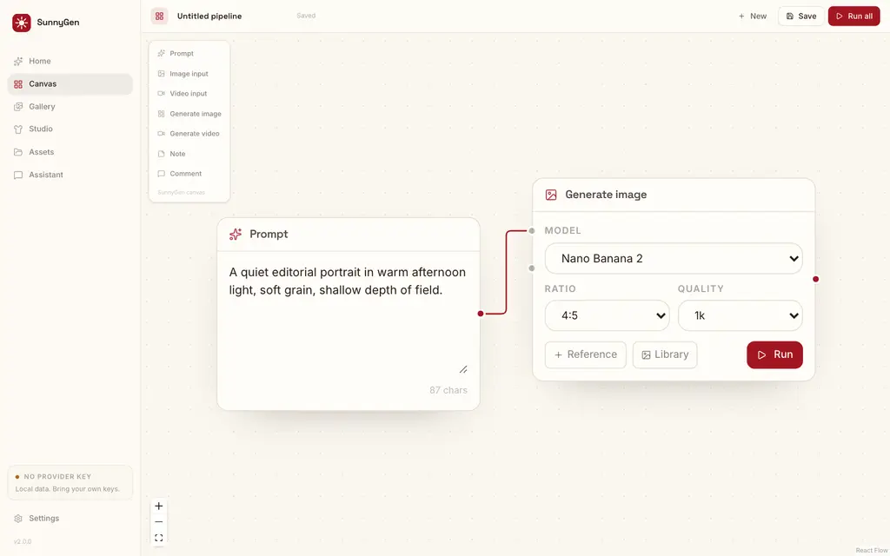
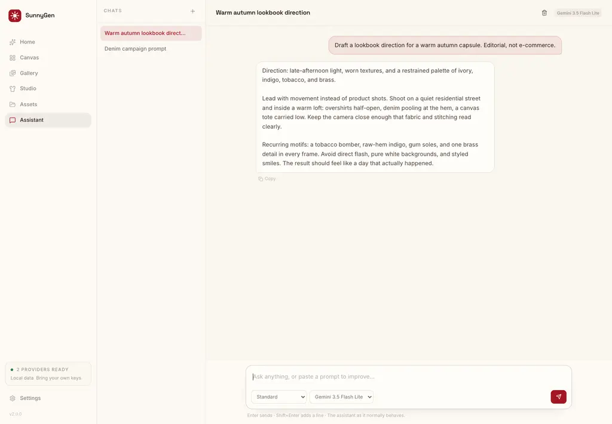
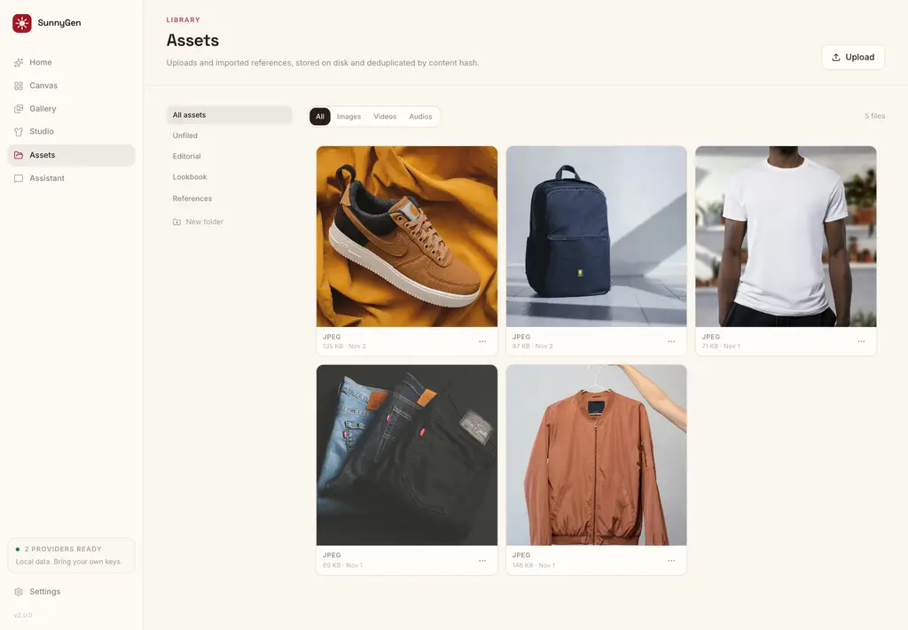
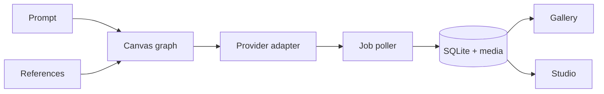

<div align="center">
  

  <h1>SunnyGen</h1>

  <p><strong>Your models. Your machine. Your library.</strong></p>

  <p>A local-first studio for building image and video generation pipelines on an infinite canvas.</p>

[](LICENSE)
[](https://nodejs.org)
[](https://tanstack.com/start)
[](#contributing)

</div>



<p align="center"><sub><strong>Studio</strong> — one avatar, up to six garments, one camera angle per render.</sub></p>

---

SunnyGen is a self-hosted alternative to cloud AI studios. Chain prompts, models, and
reference images into reusable workflows, render across your own provider accounts, and
keep every project, key, and asset on your disk.

No account. No shared credit pool. No markup. No telemetry.

## Why SunnyGen

- **Local-first by default.** SQLite, media files, and provider keys live in `data/`.
- **Provider-agnostic.** Sunra.ai, fal.ai, Azure AI Foundry, and a local Codex CLI.
- **Pipelines, not one-off prompts.** Save a canvas and re-run it with new references.
- **Studio built in.** Avatars, garment prep, poses, scenes, and multi-angle lookbooks.
- **Boring storage.** Content-addressed media, byte-range streaming, no cloud bucket required.
- **Responsive shell.** Side rail on desktop, slide-over drawer on phones, and PWA installability.
- **Hackable.** Small TypeScript packages, typed server functions, and a clean monorepo.

## Quick start

```bash
git clone https://github.com/henrychea/SunnyGen.git
cd SunnyGen
pnpm install
./sunnygen
```

Open **<http://localhost:8977>**, then:

1. **Settings → Providers** — add a Sunra.ai, fal.ai, Azure, or Codex credential.
2. **Canvas** — connect a Prompt node to a Generate node and press **Run all**.
3. **Gallery** — every finished render lands here automatically.

Prefer hot reload?

```bash
pnpm dev
```

**Requirements:** Node.js 22.20+ (24 recommended), pnpm 9.15. Docker is optional and only
needed for social imports.

### Install as an app

SunnyGen ships a web app manifest, maskable icons, and an offline app shell.

- **Chrome / Edge:** use the install icon in the address bar, or **Menu → Install SunnyGen**.
- **iPhone / iPad (Safari):** **Share → Add to Home Screen**.
- **Android (Chrome):** **Menu → Install app**.

It opens standalone, keeps the warm theme in the system UI, and caches the shell so the
interface still opens when the server is unreachable. Renders, assets, and provider calls
still need the local server and a network connection.

## A look inside

### Studio

Studio is the main workspace: pick a saved avatar, stack up to six garments in slot order,
choose a pose and scene, then render one to four angles over the same reference list.
On-model and supplier photos can be prepped into clean product references without leaving
the app.



<p align="center"><sub>The wardrobe library stores slot, source type, notes, and a prepared clean reference per piece.</sub></p>

### Gallery and canvas

| Gallery                                                                                                                       | Canvas                                                                                                                     |
| ----------------------------------------------------------------------------------------------------------------------------- | -------------------------------------------------------------------------------------------------------------------------- |
|  |  |
| Canvas wall or grid, folders, retries, lightbox, and one-off renders.                                                         | Reusable node pipelines with per-node models, references, and autosave.                                                    |

### Assistant and assets

| Assistant                                                                                                        | Assets                                                                                                        |
| ---------------------------------------------------------------------------------------------------------------- | ------------------------------------------------------------------------------------------------------------- |
|  |  |
| Prompt drafting and rewrites with selectable response modes.                                                     | Uploads and imported references, deduplicated and ready to reuse.                                             |

<p align="center"><sub>Screenshots use demo content. Demo photography from <a href="https://unsplash.com">Unsplash</a>.</sub></p>

## Features

| Surface       | What it does                                                                                                                 |
| ------------- | ---------------------------------------------------------------------------------------------------------------------------- |
| **Studio**    | Avatar sheets, wardrobe slots, garment prep, pose and scene references, then 1–4 angle renders per look.                     |
| **Canvas**    | Infinite node editor with prompt, media, generate, note, and comment nodes. Graphs autosave and execute in dependency order. |
| **Gallery**   | Image and video renders in a canvas wall or grid, folders, failed-job retry, lightbox, download, and social imports.         |
| **Assets**    | Uploads and imported references, deduplicated by SHA-256 and served with byte-range support.                                 |
| **Assistant** | OpenRouter-powered prompt drafting and rewrites with selectable response modes. Never used for generation.                   |
| **Launcher**  | One command to build, serve, publish on your LAN, and keep the app alive.                                                    |
| **PWA**       | Installable on desktop and mobile, standalone display, cached shell for offline launches.                                    |

## Providers

| Provider                                         | Models                                                     | Credential                |
| ------------------------------------------------ | ---------------------------------------------------------- | ------------------------- |
| [**Sunra.ai**](https://sunra.ai)                 | Nano Banana, Seedream, GPT Image, Veo, Kling, Grok Imagine | Sunra API key             |
| [**fal.ai**](https://fal.ai)                     | GPT Image 2 on fal                                         | fal API key               |
| [**Azure AI Foundry**](https://ai.azure.com)     | GPT Image 2 in your own deployment                         | Key, base URL, deployment |
| [**Codex CLI**](https://github.com/openai/codex) | GPT Image 2 through a ChatGPT plan                         | Local `codex` login       |
| [**OpenRouter**](https://openrouter.ai)          | Assistant chat only                                        | OpenRouter key            |

Keys are stored in your local SQLite database and only sent to the provider you choose.
Environment fallbacks: `SUNRA_API_KEY`, `FAL_KEY`, `AZURE_API_KEY`,
`OPENROUTER_API_KEY`.

If the selected provider is not configured, SunnyGen falls back to another configured
provider that supports the same model.

## Architecture



```text
apps/
  web/          TanStack Start app: routes, server functions, UI
  cli/          ./sunnygen launcher
packages/
  core/         Domain types, model catalog, pure studio/workflow logic
  db/           node:sqlite schema and repositories
  providers/    Sunra, fal, Azure, and Codex adapters
  ui/           Base UI primitives and the warm theme
```

Turborepo runs tasks; pnpm workspaces own the packages. Server-only code stays in
`.server.ts` files, and every cross-boundary call goes through typed server functions.

## Commands

| Command            | What it does                              |
| ------------------ | ----------------------------------------- |
| `./sunnygen`       | Build when stale, serve on `0.0.0.0:8977` |
| `./sunnygen --dev` | Vite dev server                           |
| `pnpm dev`         | Web app only, with hot reload             |
| `pnpm build`       | Production build                          |
| `pnpm test`        | Unit tests                                |
| `pnpm typecheck`   | TypeScript across the workspace           |
| `pnpm lint`        | Oxlint                                    |
| `pnpm format`      | Oxfmt                                     |

### Network access

`./sunnygen` prints local, LAN, Tailscale, and MagicDNS URLs, and can publish a Bonjour
name so phones and other laptops can connect:

```bash
./sunnygen --name studio     # http://studio.local:8977
./sunnygen --no-mdns
./sunnygen --port 3000
./sunnygen --background      # detach, log to .sunnygen/
./sunnygen --stop
./sunnygen --tunnel          # Cloudflare Tunnel connector
```

On macOS, `--install-service` registers a launchd job that restarts after a crash:

```bash
./sunnygen --install-service
./sunnygen --service-status
./sunnygen --restart-service
./sunnygen --uninstall-service
```

## Data & privacy

| What     | Default location   |
| -------- | ------------------ |
| Database | `data/sunnygen.db` |
| Media    | `data/media/`      |

Move either with `SUNNYGEN_DATA_DIR` and `SUNNYGEN_MEDIA_DIR`. Delete both for a full
reset. The app has no account system: if you expose it beyond localhost, put an
authenticating proxy in front of it (for example Cloudflare Access).

<details>
<summary><strong>Optional: social imports with cobalt</strong></summary>

Social post links are resolved by a local [cobalt](https://github.com/imputnet/cobalt)
container. Start it with:

```bash
./sunnygen --cobalt
./sunnygen --cobalt-status
docker compose logs -f cobalt
```

Cobalt listens on `127.0.0.1:9000`. Set `COBALT_API_URL` if it runs elsewhere, and
`COBALT_API_KEY` when your instance requires auth. Without cobalt, the rest of the app
keeps working.

</details>

<details>
<summary><strong>Optional: Codex provider</strong></summary>

Run GPT Image 2 through your own ChatGPT plan instead of API credits. The provider needs
[`codex`](https://github.com/openai/codex),
[`codex-imagegen`](https://github.com/jdmnk/codex-imagegen-cli), and a logged-in session
on the machine running SunnyGen. Containers cannot reach host binaries.

**Settings → Providers → Codex CLI** reports whether the CLI and login are ready. Run
`codex login` in a terminal if they are not.

</details>

## Contributing

Issues and pull requests are welcome. If you are changing code:

```bash
pnpm install
pnpm test
pnpm typecheck
pnpm lint
```

Keep changes narrow, add a test when behavior can regress, and open an issue first for
large features. The repo is deliberately small; new abstractions need a reason to exist.

If SunnyGen saves you time, a star helps other people find it.

## License

MIT — see [LICENSE](LICENSE).
