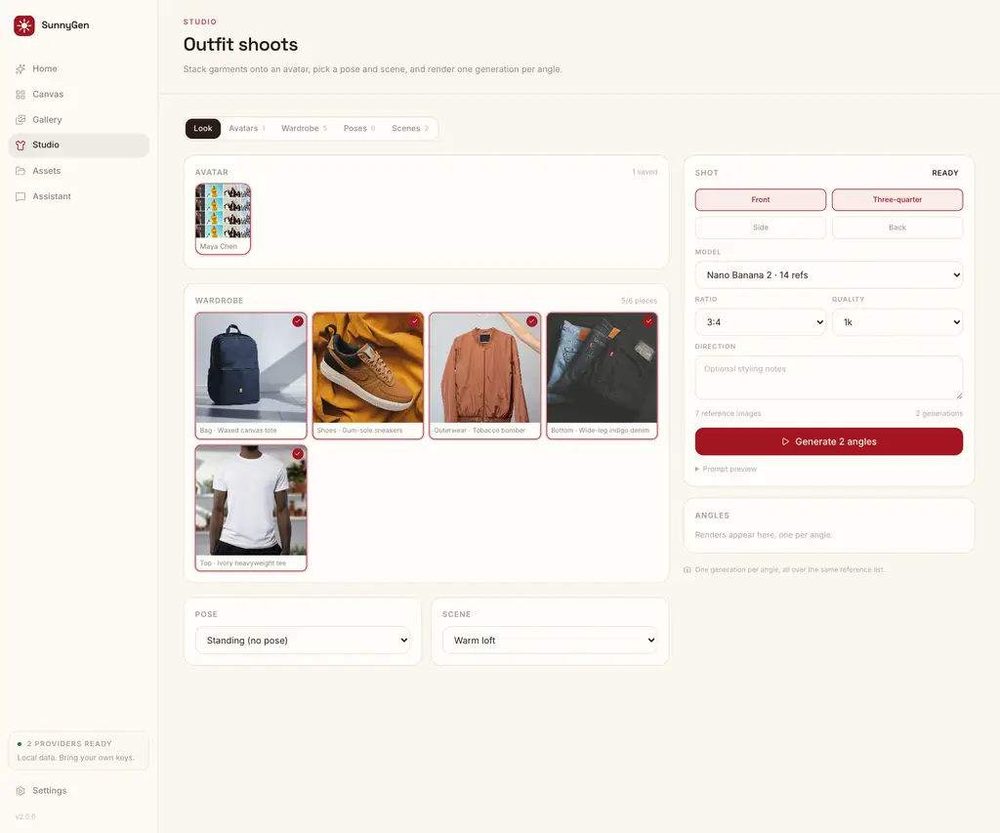
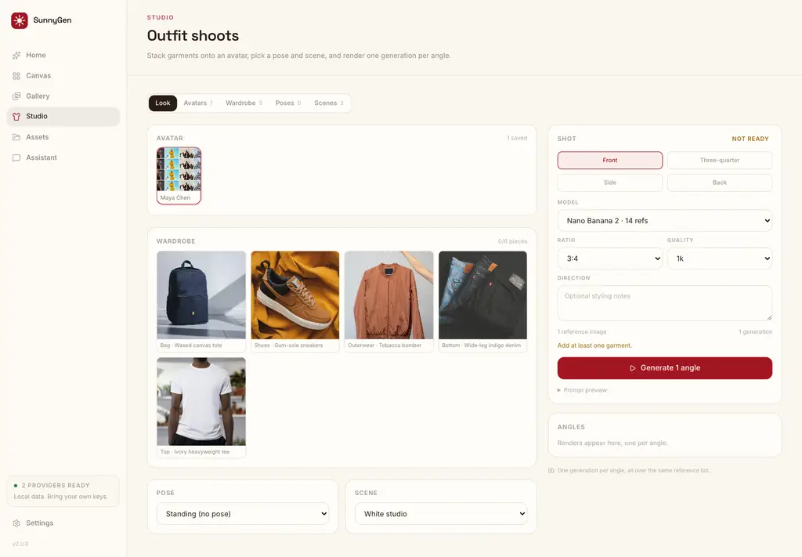
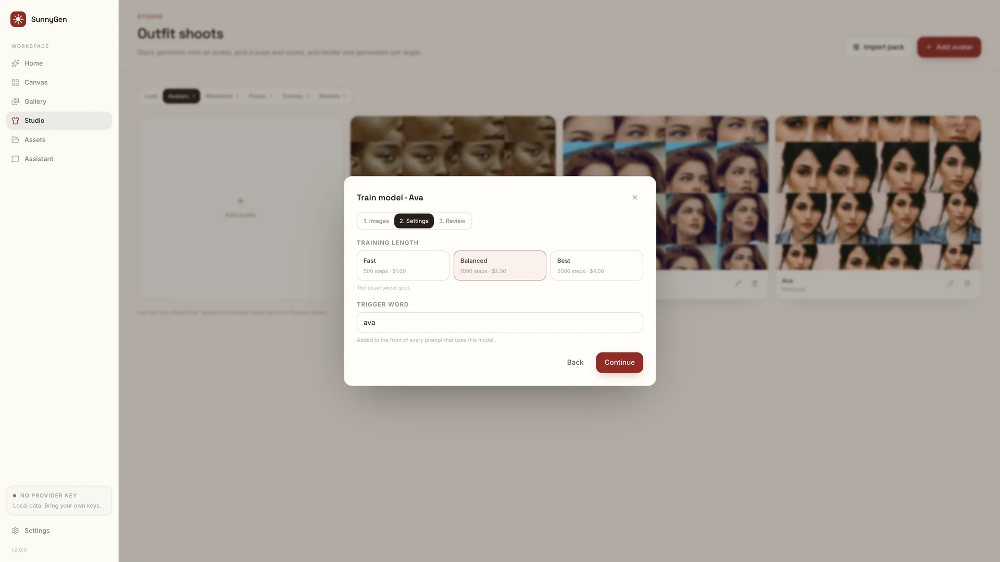
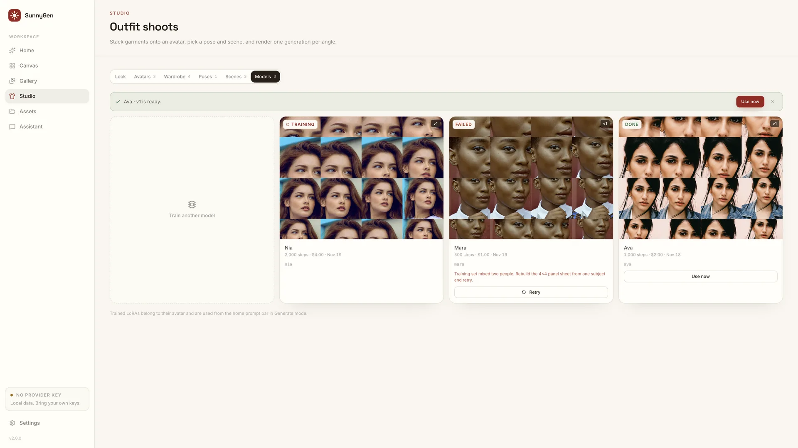
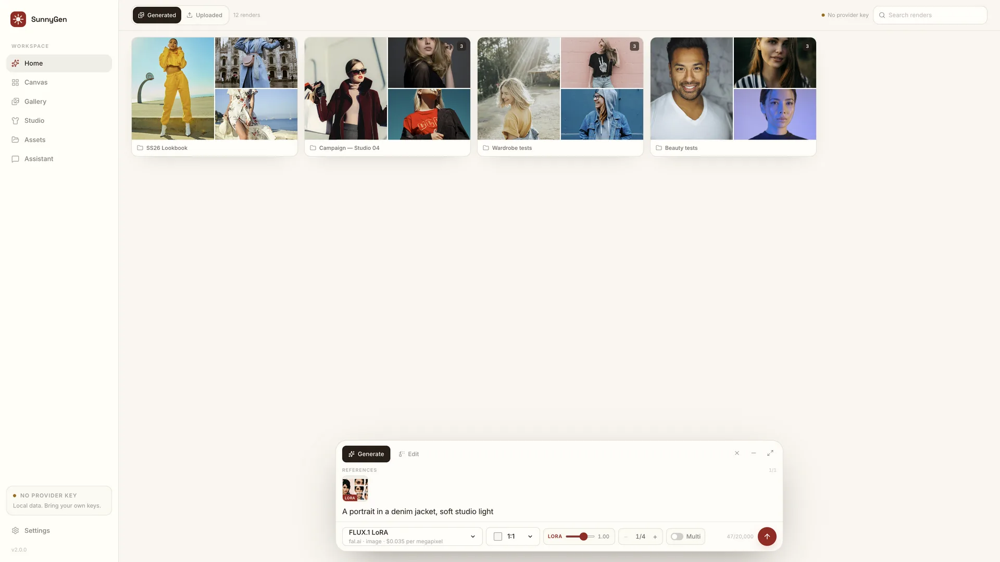
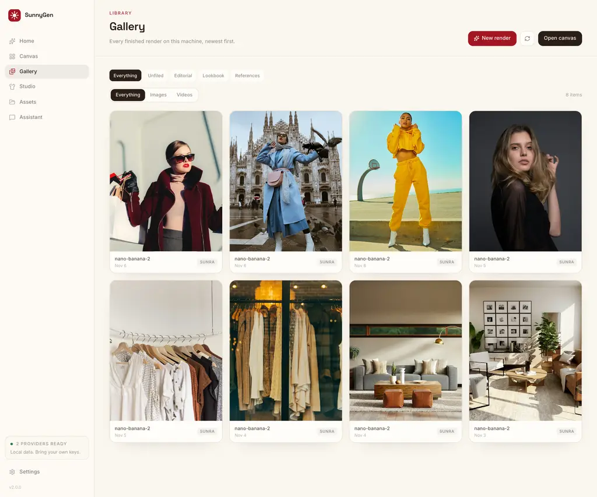
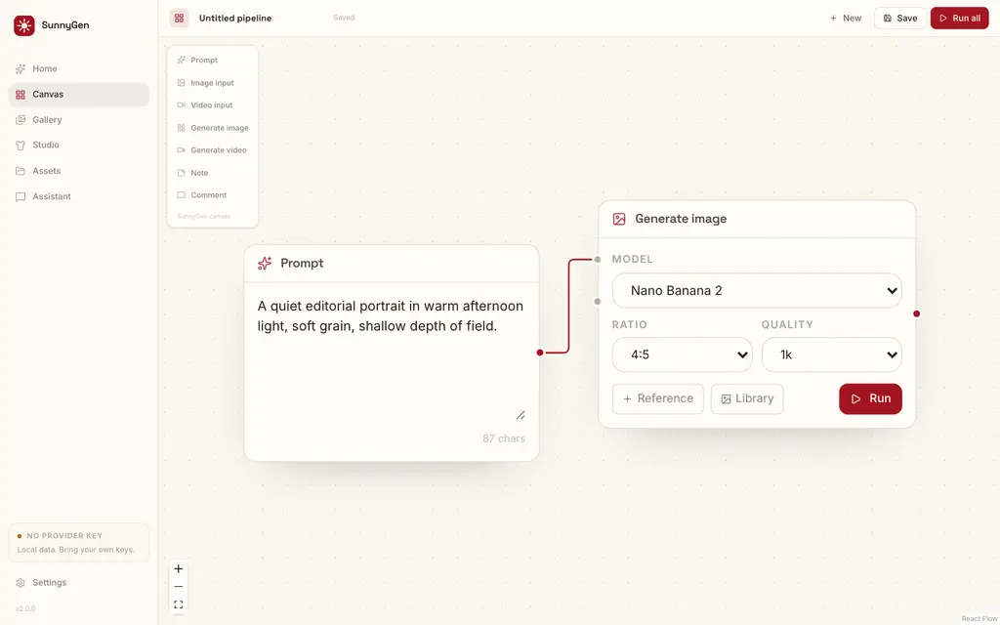
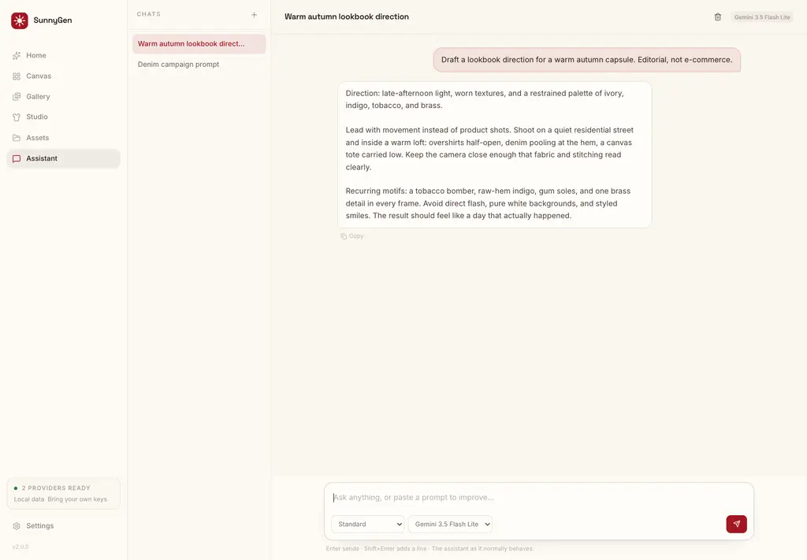
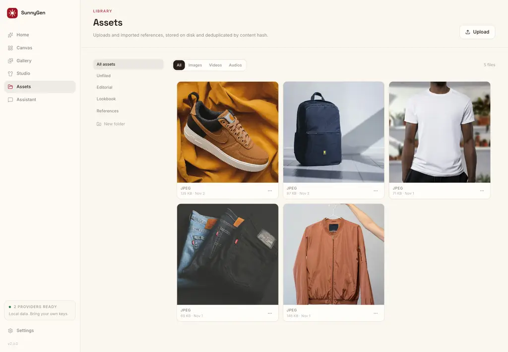
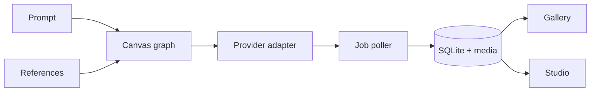

<div align="center">
  

  <h1>SunnyGen</h1>

  <p><strong>Your models. Your machine. Your library.</strong></p>

  <p>Self-hosted, open-source AI image and video generation: node-based canvas pipelines, a Studio for avatars and lookbooks, and FLUX LoRA training on your own characters.</p>

[](LICENSE)
[](https://nodejs.org)
[](https://tanstack.com/start)
[](#contributing)

</div>



<p align="center"><sub><strong>Studio</strong> — one avatar, up to six garments, one camera angle per render.</sub></p>

---

SunnyGen is an open-source, self-hosted AI image and video generator. Build reusable
pipelines on a node-based canvas, run avatar and lookbook shoots in Studio, and train FLUX
LoRAs on your own characters. Providers are bring-your-own-keys — Sunra.ai, fal.ai, Azure
AI Foundry, or a local Codex CLI — so prompts, models, and references chain into workflows
that render on your own accounts, with every project, key, and asset on your disk.

A self-hosted alternative to cloud AI studios: no account, no shared credit pool, no
markup, no telemetry.

**Contents:** [Why SunnyGen](#why-sunnygen) · [Quick start](#quick-start) ·
[A look inside](#a-look-inside) · [Features](#features) · [Providers](#providers) ·
[Architecture](#architecture) · [Commands](#commands) · [Builds](#builds) ·
[Data & privacy](#data--privacy) · [FAQ](#faq) · [Contributing](#contributing)

## Why SunnyGen

- **Local-first by default.** SQLite, media files, and provider keys live in `data/`.
- **Provider-agnostic.** Sunra.ai, fal.ai, Azure AI Foundry, and a local Codex CLI.
- **Pipelines, not one-off prompts.** Save a canvas and re-run it with new references.
- **Studio built in.** Avatars, garment prep, poses, scenes, and multi-angle lookbooks.
- **Boring storage.** Content-addressed media, byte-range streaming, no cloud bucket required.
- **Responsive shell.** Side rail on desktop, slide-over drawer on phones, and PWA installability.
- **Hackable.** Small TypeScript packages, typed server functions, and a clean monorepo.

## Quick start

```bash
git clone https://github.com/henrychea/SunnyGen.git
cd SunnyGen
pnpm install
./sunnygen
```

Open **<http://localhost:8977>**, then:

1. **Settings → Providers** — add a Sunra.ai, fal.ai, Azure, or Codex credential.
2. **Canvas** — connect a Prompt node to a Generate node and press **Run all**.
3. **Gallery** — every finished render lands here automatically.

Prefer hot reload?

```bash
pnpm dev
```

Prefer a demo instance? `pnpm dev:demo` serves a second copy on port 8978 against neutral
demo data, with no provider keys.

Prefer Docker? `docker compose -p sunnygen-prod up -d --build` builds the `sunnygen:prod`
image from the root `Dockerfile` and serves it on `0.0.0.0:8977`. See [Builds](#builds).

**Requirements:** Node.js 22.20+ (24 recommended), pnpm 9.15. Docker is optional: it runs
the production container, and social imports need a local cobalt container.

### Install as an app

SunnyGen ships a web app manifest, maskable icons, and an offline app shell.

- **Chrome / Edge:** use the install icon in the address bar, or **Menu → Install SunnyGen**.
- **iPhone / iPad (Safari):** **Share → Add to Home Screen**.
- **Android (Chrome):** **Menu → Install app**.

It opens standalone, keeps the warm theme in the system UI, and caches the shell so the
interface still opens when the server is unreachable. Renders, assets, and provider calls
still need the local server and a network connection.

## A look inside

### Studio

Studio is the main workspace: pick a saved avatar, stack up to six garments in slot order,
choose a pose and scene, then render one to four angles over the same reference list.
On-model and supplier photos can be prepped into clean product references without leaving
the app.



<p align="center"><sub>The wardrobe library stores slot, source type, notes, and a prepared clean reference per piece.</sub></p>

#### Importing packs

Studio libraries move between machines as **packs**: a `.zip` or a folder of images with an
optional `sunnygen-pack.json` mapping. Open **Studio → Poses / Wardrobe / Scenes / Avatars**
and press **Import pack**.

- A zip, or a folder picked in the browser.
- An optional mapping file. If the pack contains `sunnygen-pack.json`, `pack.json`, or
  `sunnygen.json` at its root, SunnyGen reads it automatically.
- Images only: `.png`, `.jpg`, `.jpeg`, `.webp`, `.avif`, `.gif`. Hidden files and
  `__MACOSX` are ignored.
- Items without a kind fall back to the tab you import from. Names default to the file
  stem, and duplicate names (including ones already in the library) are skipped, not
  overwritten.
- Limits: 250 MB per pack, 500 imported items. Each item is independent, so one bad file
  is reported without cancelling the rest.

Sample structure:

```text
pose-pack.zip
├── sunnygen-pack.json
├── poses/
│   ├── P001-stand.png
│   ├── P002-sit.png
│   └── P003-recline.png
└── wardrobe/
    ├── dress-silk.png
    └── dress-silk-clean.png
```

Sample mapping:

```json
{
  "name": "Reference pack 01",
  "defaults": { "data": { "tags": ["reference"] } },
  "items": [
    { "file": "poses/P001-stand.png", "kind": "pose", "name": "Standing S-curve" },
    { "file": "poses/P002-sit.png", "kind": "pose", "name": "Floor sit" },
    {
      "file": "wardrobe/dress-silk.png",
      "kind": "garment",
      "name": "Silk slip dress",
      "data": { "slot": "dress", "sourceKind": "flat-lay", "notes": "studio light" },
      "cleanFile": "wardrobe/dress-silk-clean.png"
    },
    {
      "file": "poses/P003-recline.png",
      "kind": "avatar",
      "name": "Reclining model",
      "characterSheetFile": "poses/P001-stand.png"
    }
  ]
}
```

`kind` on the manifest sets the default for every item; garment pieces need `slot`
(`top`, `bottom`, `dress`, `outerwear`, `shoes`, `bag`, `accessory`) and `sourceKind`
(`flat-lay`, `on-model`, `supplier`). Defaults are `top` and `flat-lay`. `cleanFile`
attaches a prepared reference; `characterSheetFile` is required for avatars.

A shorthand map works when you only need names or per-file overrides:

```json
{
  "kind": "pose",
  "files": {
    "poses/P001-stand.png": { "name": "Standing S-curve" },
    "poses/P002-sit.png": { "include": false }
  }
}
```

Files not listed in a manifest are skipped with a reason, and `"include": false` excludes
an entry. The import dialog reports counts plus the first few skips and failures.

### LoRA training

Train a FLUX LoRA on an avatar you already keep in Studio, then reuse that likeness in
every later render. Pick the avatar, choose 10–40 crops cut from its character sheet and
4×4 panel, pick a training length, and set the trigger word SunnyGen prepends to prompts
that use the model. Training runs on fal.ai at $2 per 1,000 steps — 500 steps for $1.00,
1,000 for $2.00, 2,000 for $4.00 — charged to your own fal account.



<p align="center"><sub>Three training lengths, an explicit total cost before you start, and one trigger word per model.</sub></p>



<p align="center"><sub>Every run is listed with its status, steps, and cost; a failed run keeps its reason and a retry.</sub></p>



<p align="center"><sub>A trained model shows up as FLUX.1 LoRA in the prompt bar, with a strength slider and its per-megapixel price.</sub></p>

### Gallery and canvas

| Gallery                                                                                                                                                                                                  | Canvas                                                                                                                                                                                            |
| -------------------------------------------------------------------------------------------------------------------------------------------------------------------------------------------------------- | ------------------------------------------------------------------------------------------------------------------------------------------------------------------------------------------------- |
|  |  |
| Canvas wall or grid, folders, retries, lightbox, and one-off renders.                                                                                                                                    | Reusable node pipelines with per-node models, references, and autosave.                                                                                                                           |

### Assistant and assets

| Assistant                                                                                                                                                                     | Assets                                                                                                                                                                          |
| ----------------------------------------------------------------------------------------------------------------------------------------------------------------------------- | ------------------------------------------------------------------------------------------------------------------------------------------------------------------------------- |
|  |  |
| Prompt drafting and rewrites with selectable response modes.                                                                                                                  | Uploads and imported references, deduplicated and ready to reuse.                                                                                                               |

<p align="center"><sub>Screenshots use demo content. Demo photography from <a href="https://unsplash.com">Unsplash</a>.</sub></p>

## Features

| Surface       | What it does                                                                                                                 |
| ------------- | ---------------------------------------------------------------------------------------------------------------------------- |
| **Studio**    | Avatar sheets, wardrobe slots, garment prep, pose and scene references, then 1–4 angle renders per look.                     |
| **LoRA**      | FLUX LoRA training on an avatar from 10–40 crops at $2 per 1,000 steps, then FLUX.1 LoRA renders on fal.ai.                  |
| **Canvas**    | Infinite node editor with prompt, media, generate, note, and comment nodes. Graphs autosave and execute in dependency order. |
| **Gallery**   | Image and video renders in a canvas wall or grid, folders, failed-job retry, lightbox, download, and social imports.         |
| **Assets**    | Uploads and imported references, deduplicated by SHA-256 and served with byte-range support.                                 |
| **Assistant** | OpenRouter-powered prompt drafting and rewrites with selectable response modes. Never used for generation.                   |
| **Launcher**  | One command to build, serve, publish on your LAN, and keep the app alive.                                                    |
| **PWA**       | Installable on desktop and mobile, standalone display, cached shell for offline launches.                                    |

## Providers

| Provider                                         | Models                                                     | Credential                |
| ------------------------------------------------ | ---------------------------------------------------------- | ------------------------- |
| [**Sunra.ai**](https://sunra.ai)                 | Nano Banana, Seedream, GPT Image, Veo, Kling, Grok Imagine | Sunra API key             |
| [**fal.ai**](https://fal.ai)                     | GPT Image 2, FLUX.1 LoRA, LoRA training                    | fal API key               |
| [**Azure AI Foundry**](https://ai.azure.com)     | GPT Image 2 in your own deployment                         | Key, base URL, deployment |
| [**Codex CLI**](https://github.com/openai/codex) | GPT Image 2 through a ChatGPT plan                         | Local `codex` login       |
| [**OpenRouter**](https://openrouter.ai)          | Assistant chat only                                        | OpenRouter key            |

Keys are stored in your local SQLite database and only sent to the provider you choose.
Environment fallbacks: `SUNRA_API_KEY`, `FAL_KEY`, `AZURE_API_KEY`,
`OPENROUTER_API_KEY`.

Sunra.ai and fal.ai can push finished jobs to SunnyGen instead of waiting for the next
poll. Set `SUNNYGEN_PUBLIC_URL` to the origin providers can reach (for example a
Cloudflare Tunnel hostname) and submissions register a token-scoped
`/api/webhooks/<provider>/<token>` callback. Polling stays enabled as the fallback, and
no callback is registered while the variable is unset.

If the selected provider is not configured, SunnyGen falls back to another configured
provider that supports the same model.

## Architecture



```text
apps/
  web/          TanStack Start app: routes, server functions, UI
  cli/          ./sunnygen launcher
packages/
  core/         Domain types, model catalog, pure studio/workflow logic
  db/           node:sqlite schema and repositories
  providers/    Sunra, fal, Azure, and Codex adapters
  ui/           Base UI primitives and the warm theme
```

Turborepo runs tasks; pnpm workspaces own the packages. Server-only code stays in
`.server.ts` files, and every cross-boundary call goes through typed server functions.

## Commands

| Command            | What it does                              |
| ------------------ | ----------------------------------------- |
| `./sunnygen`       | Build when stale, serve on `0.0.0.0:8977` |
| `./sunnygen --dev` | Vite dev server                           |
| `pnpm dev`         | Web app only, with hot reload             |
| `pnpm build`       | Production build                          |
| `pnpm test`        | Unit tests                                |
| `pnpm typecheck`   | TypeScript across the workspace           |
| `pnpm lint`        | Oxlint                                    |
| `pnpm format`      | Oxfmt                                     |

### Network access

`./sunnygen` prints local, LAN, Tailscale, and MagicDNS URLs, and can publish a Bonjour
name so phones and other laptops can connect:

```bash
./sunnygen --name studio     # http://studio.local:8977
./sunnygen --no-mdns
./sunnygen --port 3000
./sunnygen --background      # detach, log to .sunnygen/
./sunnygen --stop
./sunnygen --tunnel          # Cloudflare Tunnel connector
```

`--install-service` registers a login service that restarts after a crash: launchd on
macOS, `systemd --user` on Linux (enabled for boot start via lingering):

```bash
./sunnygen --install-service
./sunnygen --service-status
./sunnygen --restart-service
./sunnygen --uninstall-service
```

On Linux the unit is `~/.config/systemd/user/sunnygen.service` and logs go to
`journalctl --user -u sunnygen.service -f`. It serves the existing production build,
so run `./sunnygen --build` after changing sources, then `./sunnygen --restart-service`.

## Builds

| Build | How it runs                                                             | Data                                                                                  |
| ----- | ----------------------------------------------------------------------- | ------------------------------------------------------------------------------------- |
| Prod  | Docker image from the root `Dockerfile`, host network on `0.0.0.0:8977` | `SUNNYGEN_PROD_DATA`, default `~/.local/share/sunnygen-prod/data`, mounted at `/data` |
| Demo  | `pnpm dev:demo`, the Vite dev server on port 8978                       | `SUNNYGEN_DEMO_DATA`, default `~/.local/share/sunnygen-demo/data`                     |

```bash
docker compose -p sunnygen-prod up -d --build   # prod
pnpm dev:demo                                   # demo
```

The demo build runs a neutral screenshot dataset with no provider keys; never point it
at prod data. `scripts/deploy-prod.sh` is safe on a timer: it exits quietly when
`origin/main` has not moved, and a failed build leaves the running container in place.

## Data & privacy

| What       | Default location   |
| ---------- | ------------------ |
| Database   | `data/sunnygen.db` |
| Media      | `data/media/`      |
| Master key | `data/secrets.key` |

Move either with `SUNNYGEN_DATA_DIR` and `SUNNYGEN_MEDIA_DIR`. Delete both for a full
reset. The app has no account system: if you expose it beyond localhost, put an
authenticating proxy in front of it (for example Cloudflare Access).

Provider and assistant API keys are encrypted in SQLite with AES-256-GCM. The master
key lives in `data/secrets.key` with `0600` permissions and is generated on first use.
Set `SUNNYGEN_SECRET` to supply the master key instead (64 hex characters, base64 for 32
bytes, or a passphrase stretched with scrypt using `data/secrets.salt`). Keep that value
stable: changing it makes existing encrypted keys unreadable. Because the default key
file sits next to the database, encryption protects database copies and backups, not a
full compromise of the data directory.

<details>
<summary><strong>Optional: social imports with cobalt</strong></summary>

Social post links are resolved by a local [cobalt](https://github.com/imputnet/cobalt)
container. Start it with:

```bash
./sunnygen --cobalt
./sunnygen --cobalt-status
docker compose logs -f cobalt
```

Cobalt listens on `127.0.0.1:9000`. Set `COBALT_API_URL` if it runs elsewhere, and
`COBALT_API_KEY` when your instance requires auth. Without cobalt, the rest of the app
keeps working.

On Linux, `./sunnygen --install-service` also installs `sunnygen-cobalt.service`,
which runs `docker compose up -d cobalt` for your session and `compose down` on stop.
It needs a reachable Docker daemon (`sudo systemctl enable --now docker`) and a user in
the `docker` group (`sudo usermod -aG docker "$USER"`, then log out and back in). The
container also carries `restart: unless-stopped`, so Docker brings it back on reboot.

</details>

<details>
<summary><strong>Optional: Codex provider</strong></summary>

Run GPT Image 2 through your own ChatGPT plan instead of API credits. The provider needs
[`codex`](https://github.com/openai/codex),
[`codex-imagegen`](https://github.com/jdmnk/codex-imagegen-cli), and a logged-in session
on the machine running SunnyGen. Containers cannot reach host binaries.

**Settings → Providers → Codex CLI** reports whether the CLI and login are ready. Run
`codex login` in a terminal if they are not.

</details>

## FAQ

### Is SunnyGen free?

The app is MIT-licensed and costs nothing to run. You pay the providers you connect —
Sunra.ai, fal.ai, Azure, or your own ChatGPT plan through the Codex CLI — at their prices,
with no subscription and no markup.

### Does it run fully offline, and where are my images stored?

Generation needs a network connection to the provider you choose; everything else is
local. Renders, uploads, references, the SQLite database, and the encrypted key file live
under `data/` on your machine, and an installed PWA still opens its shell offline.

### Which AI models does it support?

Nano Banana 2 and Pro, Seedream 5.0 Lite and Pro, GPT Image 2, Grok Imagine, FLUX.1 LoRA,
Veo 3.1, and Kling 3.0, routed through Sunra.ai, fal.ai, Azure AI Foundry, or the Codex
CLI. The catalog lives in [`packages/core`](packages/core) and grows with each release.

### Can I train a LoRA on my own face or character?

Yes. Any avatar in Studio can become a FLUX LoRA from 10–40 crops of its character sheet
and 4×4 panel, at $2 per 1,000 training steps on your fal.ai account. Attach the avatar as
a reference in the home prompt bar and the composer points you to the FLUX.1 LoRA model.

### Does it work on mobile?

The interface is responsive and installs as a PWA on iOS and Android, with a cached shell
that opens offline. Renders still go through your SunnyGen server, so reach it over your
LAN, Tailscale, or a Cloudflare Tunnel.

### Can I self-host with Docker?

Yes. `docker compose -p sunnygen-prod up -d --build` builds the `sunnygen:prod` image from
the root `Dockerfile`, serves it on `0.0.0.0:8977`, and mounts the data directory from the
host — `SUNNYGEN_PROD_DATA`, default `~/.local/share/sunnygen-prod/data`.

## Contributing

Issues and pull requests are welcome. Read [CONTRIBUTING.md](CONTRIBUTING.md) for the
full guide, including review etiquette and what makes a focused change. If you are
changing code:

```bash
pnpm install
pnpm test
pnpm typecheck
pnpm lint
```

Keep changes narrow, add a test when behavior can regress, and open an issue first for
large features. The repo is deliberately small; new abstractions need a reason to exist.

If SunnyGen saves you time, a star helps other people find it.

## License

MIT — see [LICENSE](LICENSE).
